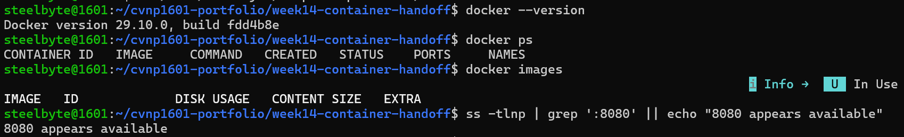
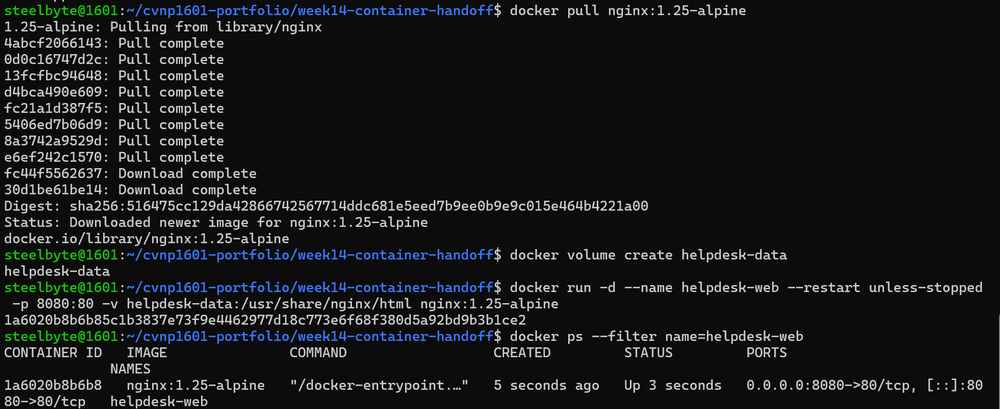
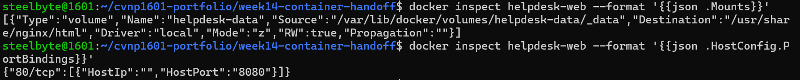
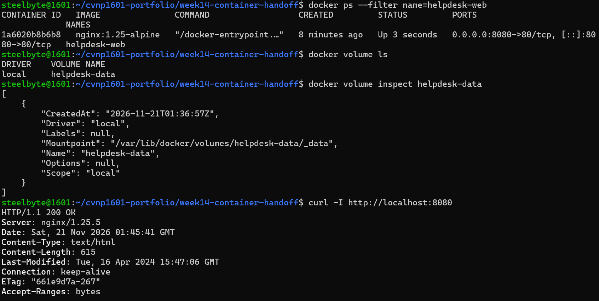
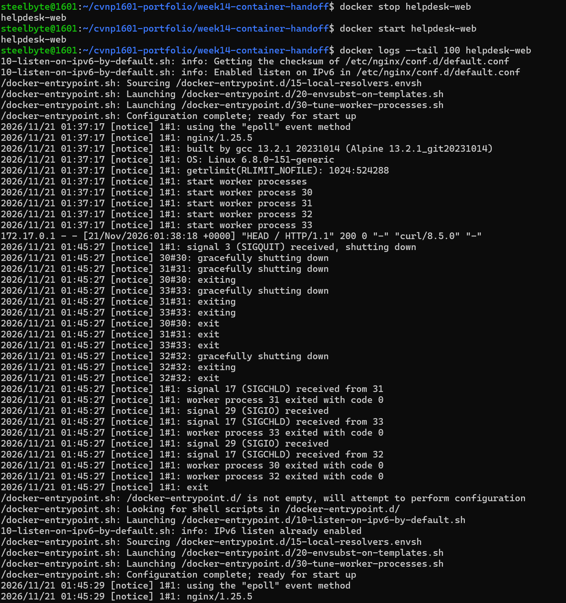

# Week 14: Container Handoff

**Ticket CVNP1601-W14-014: Deploy an internal web tool as a container and document support commands**

---

## Objectives

- Record a runtime baseline of the Docker host before deployment
- Run a container with an explicit image tag, container name, port mapping, named volume, and restart policy
- Verify the service across the Docker, application, and user boundaries with docker ps, docker logs, docker inspect, and curl
- Prove restart and persistence behavior with a named volume
- Write a container handoff runbook with verification, rollback, cleanup, and a troubleshooting table
- Diagnose a container that shows Up in docker ps but refuses connections

## Tools Used

- `docker --version`
- `docker ps`
- `docker images`
- `ss -tlnp`
- `docker pull`
- `docker volume create`
- `docker run`
- `curl -I`
- `docker logs`
- `docker inspect`
- `docker restart`
- `docker volume ls`
- `docker volume inspect`
- `docker stop`
- `docker start`
- `docker rm -f` (documented cleanup only)
- `apt`, `sed`, `nginx -t`, `dpkg --configure -a`, `usermod` (host troubleshooting, see Troubleshooting Notes)

---

## Configuration

### Ticket Information

- **Ticket ID:** CVNP1601-W14-014
- **Submitted by:** Application owner
- **Affected system:** Docker host, containerized web service, named volume, host port
- **Reported request:** Deploy an internal web tool as a container and document support commands
- **Business impact:** Medium
- **Security consideration:** Undocumented tags, ports, volumes, and cleanup commands can expose services or destroy data
- **Required outcome:** Container runs with explicit name, tag, port, restart policy, persistence decision, logs, inspect evidence, and host-level verification

### Scenario Summary

The team received a small internal web tool packaged as a container. The job was not to write application code but to run it predictably, expose the correct port, check its logs, preserve its data, and document how another admin can verify or replace it. The work was done on the course lab VM, VMID 102, hostname 1601, Ubuntu Server 24.04 LTS at 10.10.50.103, using Docker Engine 29.10.0 and the approved image nginx:1.25-alpine. Docker was not installed on the VM at the start, and a leftover nginx typo from an earlier lesson was blocking apt, so both were resolved before Task 1 could be captured. Those deviations are documented in Troubleshooting Notes.

---

## Task 1: Prepare and Record Runtime Baseline

```bash
docker --version
```

```bash
docker ps
```

```bash
docker images
```

```bash
ss -tlnp | grep ':8080' || echo "8080 appears available"
```

**What it does:** Confirms Docker is installed, lists any running containers and local images, and checks whether host port 8080 is already in use.

**Expected output includes:** A Docker version line, empty container and image lists, and 8080 appears available.

**Result:** Docker version 29.10.0, build fdd4b8e. No containers, no images, and port 8080 available.



**Status:** Complete

---

## Task 2: Run a Container with Explicit Settings

```bash
docker pull nginx:1.25-alpine
```

```bash
docker volume create helpdesk-data
```

```bash
docker run -d --name helpdesk-web --restart unless-stopped -p 8080:80 -v helpdesk-data:/usr/share/nginx/html nginx:1.25-alpine
```

```bash
docker ps --filter name=helpdesk-web
```

**What it does:** Pulls the pinned image, creates the named volume, starts the container detached with an explicit name, restart policy, port mapping, and volume, then confirms it is running.

**Expected output includes:** Status: Downloaded newer image for nginx:1.25-alpine, the volume name helpdesk-data, a container ID, and a docker ps row showing nginx:1.25-alpine, Up, 0.0.0.0:8080->80/tcp, and helpdesk-web.

**Result:** Image nginx:1.25-alpine pulled, volume helpdesk-data created, and helpdesk-web running with 0.0.0.0:8080->80/tcp and [::]:8080->80/tcp. The pinned tag was used instead of latest so the verified image is the one that keeps running after any future pull or recreation.



**Status:** Complete

---

## Task 3: Verify, Inspect, and Capture Logs

```bash
curl -I http://localhost:8080
```

```bash
docker logs --tail 50 helpdesk-web
```

```bash
docker inspect helpdesk-web
```

```bash
docker inspect helpdesk-web --format '{{json .Mounts}}'
```

```bash
docker inspect helpdesk-web --format '{{json .HostConfig.PortBindings}}'
```

**What it does:** Tests the service over HTTP through the host port, reads what the container process logged, and pulls the full configuration plus the mount and port binding fields.

**Expected output includes:** HTTP/1.1 200 OK, nginx startup lines and the logged curl request, a running state in inspect, the helpdesk-data volume at /usr/share/nginx/html, and 80/tcp bound to HostPort 8080.

**Result:**

The use of curl -I http://localhost:8080 proves that the application responds to HTTP requests via the host port as evidenced by the HTTP/1.1 200 OK returned by version 1.25.5 of nginx.

The docker logs --tail 50 helpdesk-web command proves that the nginx process within the container successfully started, and processed actual traffic since this command output includes the entry point completing the configuration, the worker processes initializing, and my own HEAD request being logged into the Docker log as having been responded to with a 200 status, coming from the Docker bridge network gateway at IP address 172.17.0.1.

The docker inspect helpdesk-web command proves that the container was created with the desired configuration options; these include a running state, the pinned image nginx:1.25-alpine, the unless-stopped restart policy, and that port 80/tcp has been published on host port 8080 for both IPv4 and IPv6.

The docker inspect helpdesk-web --format '{{json .Mounts}}' command proves that the named volume helpdesk-data has been mounted read/write at /usr/share/nginx/html, with the data stored on the host at /var/lib/docker/volumes/helpdesk-data/_data rather than in a temporary layer for the disposable container.

The docker inspect helpdesk-web --format '{{json .HostConfig.PortBindings}}' command proves that there is a port mapping of host port 8080 to container port 80/tcp. An empty HostIp means that it will listen on all host addresses.



**Status:** Complete

---

## Task 4: Prove Restart and Persistence Behavior

```bash
docker restart helpdesk-web
```

```bash
docker ps --filter name=helpdesk-web
```

```bash
docker volume ls
```

```bash
docker volume inspect helpdesk-data
```

```bash
curl -I http://localhost:8080
```

**What it does:** Restarts the container, confirms it came back, confirms the named volume still exists independently of the container, and re-tests the service over HTTP.

**Expected output includes:** helpdesk-web echoed by the restart, STATUS Up with the same container ID and port mapping, helpdesk-data in the volume list with its mountpoint, and HTTP/1.1 200 OK.

**Result:** The container came back Up 3 seconds while CREATED still showed 8 minutes ago, proving the same container object restarted. helpdesk-data was still listed with the same CreatedAt of 2026-11-21T01:36:57Z and mountpoint /var/lib/docker/volumes/helpdesk-data/_data. curl returned HTTP/1.1 200 OK with the same ETag 661e9d7a-267 as before the restart.



**Status:** Complete

---

## Task 5: Write the Container Handoff

```bash
docker stop helpdesk-web
```

```bash
docker start helpdesk-web
```

```bash
docker logs --tail 100 helpdesk-web
```

```bash
cat > ~/cvnp1601-portfolio/week14-container-handoff/docker-run.txt <<'EOF'
docker pull nginx:1.25-alpine
docker volume create helpdesk-data
docker run -d --name helpdesk-web --restart unless-stopped -p 8080:80 -v helpdesk-data:/usr/share/nginx/html nginx:1.25-alpine
EOF
```

```bash
cat ~/cvnp1601-portfolio/week14-container-handoff/docker-run.txt
```

**What it does:** Stops and starts the container to show the stop and start cycle in the logs, then saves the exact start commands to docker-run.txt.

**Expected output includes:** helpdesk-web echoed by both stop and start, a SIGQUIT graceful shutdown followed by a fresh nginx start in the logs, and the three start commands printed from docker-run.txt.

**Result:** At 01:47:59 nginx received SIGQUIT and all workers exited with code 0. At 01:48:02 the entrypoint ran again and nginx started four new workers. docker-run.txt contains the exact Task 2 commands.



**Status:** Complete

### Container Handoff: helpdesk-web

**Start command:** the exact commands are saved in docker-run.txt. Pull the pinned image with docker pull nginx:1.25-alpine, create the volume with docker volume create helpdesk-data, then start the container with docker run -d --name helpdesk-web --restart unless-stopped -p 8080:80 -v helpdesk-data:/usr/share/nginx/html nginx:1.25-alpine.

**Verification URL:** http://localhost:8080 on the Docker host. Run curl -I http://localhost:8080 and expect HTTP/1.1 200 OK with Server: nginx/1.25.5.

**Expected docker ps state:** run docker ps --filter name=helpdesk-web and expect IMAGE nginx:1.25-alpine, STATUS Up, PORTS 0.0.0.0:8080->80/tcp and [::]:8080->80/tcp, and NAMES helpdesk-web.

**Logs command:** docker logs --tail 50 helpdesk-web for routine triage, or docker logs --tail 100 helpdesk-web for a longer view. A healthy start shows the entrypoint reporting Configuration complete; ready for start up, followed by nginx starting its worker processes.

**Inspect commands:** docker inspect helpdesk-web for the full configuration, docker inspect helpdesk-web --format '{{json .Mounts}}' to confirm the volume, and docker inspect helpdesk-web --format '{{json .HostConfig.PortBindings}}' to confirm the port mapping. Expected results are the helpdesk-data volume mounted read-write at /usr/share/nginx/html, and container port 80/tcp bound to host port 8080.

**Volume decision:** the named volume helpdesk-data is mounted at /usr/share/nginx/html, which is the directory nginx serves its web content from. The data lives on the host at /var/lib/docker/volumes/helpdesk-data/_data instead of in the disposable container layer, so any content placed there survives a restart or recreation of the container. docker volume inspect helpdesk-data confirmed the volume exists independently of the container.

**Restart behavior:** the restart policy is unless-stopped, so Docker brings the container back after a daemon restart or host reboot unless an admin stopped it on purpose. docker restart helpdesk-web was tested. The container came back Up with the same container ID, the same port mapping and the same volume, and curl returned 200 OK with the same ETag as before. A restart policy only keeps the container running. It doesn't prove the application is healthy, so always confirm with curl and the logs.

**Stop and start:** docker stop helpdesk-web stops the container gracefully, and nginx logs a SIGQUIT and shuts its workers down with code 0. docker start helpdesk-web starts the same container again. The container object and its logs survive a stop.

**Rollback command:** to restore the known good deployment, remove the container with docker rm -f helpdesk-web, then rerun the exact docker run command from docker-run.txt with the same pinned tag nginx:1.25-alpine, the same name, port, volume and restart policy. Because the data is in the named volume, the new container picks up the same content. If a newer tag is ever deployed and fails, rolling back means running this same command with nginx:1.25-alpine as the tag.

**Cleanup warning:** docker rm -f helpdesk-web permanently deletes the container object and its logs, so capture every piece of evidence before running it. It does not delete the helpdesk-data volume. docker volume rm helpdesk-data is a separate command that permanently destroys the stored content, and it should only be run when the data is confirmed to be no longer needed.

### Troubleshooting Table

| Symptom | First command | Expected evidence | Likely cause and fix |
|---|---|---|---|
| Image pull denied | docker pull nginx:1.25-alpine | An error saying pull access is denied, or that the repository does not exist or may require docker login | A misspelled image name or tag, or a private registry that needs authentication. Correct the name and tag, or run docker login for the registry. |
| Port already allocated | ss -tlnp \| grep ':8080' together with docker ps -a | docker run fails with a bind error saying port 8080 is already allocated, and ss or docker ps -a shows another process or container holding 8080 | An old container or another service is using the host port. Remove the old container, or choose a different host port and document the change. |
| Container exits immediately | docker ps -a | STATUS shows Exited with an exit code, for example 1 for a general error or 137 for a SIGKILL. Next, docker logs helpdesk-web shows the actual error | A bad configuration, a missing environment variable or a wrong path. Read the logs before removing anything, fix the cause, then recreate. |
| curl connection refused | docker ps --filter name=helpdesk-web | Either the container isn't Up, or the PORTS column is missing or reversed from 0.0.0.0:8080->80/tcp. If the mapping looks correct, check docker logs helpdesk-web to see which address and port the application is listening on inside the container, and docker inspect helpdesk-web --format '{{json .HostConfig.PortBindings}}' to confirm the binding | A stopped container, a flipped -p mapping, or an application bound only to 127.0.0.1 inside the container. Start it, recreate it with the correct mapping, or configure the application to listen on all interfaces. |
| Data missing after recreation | docker inspect helpdesk-web --format '{{json .Mounts}}' | An empty result [] means the container was recreated without the -v flag, while docker volume ls still shows helpdesk-data | The data was in the volume, but the new container was never attached to it. Stop and remove the container, then rerun the exact command from docker-run.txt with -v helpdesk-data:/usr/share/nginx/html. |

---

## Task 6: Break/Fix Diagnostic

Paper exercise. The reportgen-web container, the registry.local/reportgen:2.3 image, and host14 are fictional, and nothing from the scenario was run on the lab VM.

**Result:** The full State, Root Cause, Remediation, and Verification answer is in week14-diagnosis.md. The root cause is that the application is bound to 127.0.0.1 inside the container, so traffic forwarded through the Docker port mapping to the container's bridge interface is refused, even though docker ps and docker inspect both show a correct mapping.

**Status:** Complete

---

## Troubleshooting Notes

### Issue 1: Docker was not installed on the lab VM

**Incorrect command:**

```bash
docker --version
```

**Root Cause:** The assignment assumes a Docker host, but Docker Engine was not installed on VM 102. command -v docker returned nothing, groups showed no docker group, and docker --version returned Command 'docker' not found.

**Resolution:** Installed Docker Engine from Docker's official apt repository, following Docker's documented install sequence for Ubuntu 24.04.

```bash
sudo apt remove $(dpkg --get-selections docker.io docker-compose docker-compose-v2 docker-doc docker-buildx podman-docker containerd runc | cut -f1)
```

```bash
sudo apt update
```

```bash
sudo apt install ca-certificates curl
```

```bash
sudo install -m 0755 -d /etc/apt/keyrings
```

```bash
sudo curl -fsSL https://download.docker.com/linux/ubuntu/gpg -o /etc/apt/keyrings/docker.asc
```

```bash
sudo chmod a+r /etc/apt/keyrings/docker.asc
```

```bash
sudo tee /etc/apt/sources.list.d/docker.sources <<EOF
Types: deb
URIs: https://download.docker.com/linux/ubuntu
Suites: $(. /etc/os-release && echo "${UBUNTU_CODENAME:-$VERSION_CODENAME}")
Components: stable
Architectures: $(dpkg --print-architecture)
Signed-By: /etc/apt/keyrings/docker.asc
EOF
```

```bash
sudo apt update
```

**Result:** The Docker repository was added for noble/stable amd64. The install itself was completed in Issue 3.

### Issue 2: apt was blocked by a half-configured nginx package

**Incorrect command:**

```bash
sudo apt remove $(dpkg --get-selections docker.io docker-compose docker-compose-v2 docker-doc docker-buildx podman-docker containerd runc | cut -f1)
```

**Root Cause:** The host nginx package was left half configured by an earlier lesson. Line 46 of /etc/nginx/sites-enabled/default still contained server_nmae instead of server_name, so nginx failed its configuration test with unknown directive server_nmae, dpkg returned error code 1, and every apt operation stopped on it.

**Resolution:** Confirmed the typo, fixed only line 46 with sed using --follow-symlinks so the symlinked site file stayed a symlink, tested the configuration, and finished the interrupted package setup.

```bash
sed -n '46p' /etc/nginx/sites-enabled/default
```

```bash
sudo sed --follow-symlinks -i '46s/server_nmae/server_name/' /etc/nginx/sites-enabled/default
```

```bash
sudo nginx -t
```

```bash
sudo dpkg --configure -a
```

**Result:** nginx -t reported syntax is ok and test is successful, dpkg finished Setting up nginx, and apt worked normally again.

### Issue 3: usermod failed because the docker group did not exist

**Incorrect command:**

```bash
sudo usermod -aG docker $USER
```

**Root Cause:** The apt install docker-ce step was skipped on the first pass, so Docker Engine was never installed and the docker group was never created. usermod returned group 'docker' does not exist, and the Task 1 commands still returned command not found.

**Resolution:** Applied the 38 pending package updates, which included kernel 6.8.0-151, ran the missed install step, added the user to the docker group, and rebooted so the new group membership and the new kernel both took effect.

```bash
sudo apt upgrade
```

```bash
sudo apt install docker-ce docker-ce-cli containerd.io docker-buildx-plugin docker-compose-plugin
```

```bash
sudo usermod -aG docker $USER
```

```bash
sudo reboot
```

```bash
groups
```

**Result:** groups showed the docker group, docker --version returned Docker version 29.10.0, and all Task 1 through 5 commands ran without sudo exactly as the assignment lists them. Membership in the docker group grants root-level access to the host through the Docker socket, which is acceptable on this single-user lab VM.

---

## Portfolio Card

### What I Can Do Now

I deployed and verified a containerized nginx web service with Docker using a pinned image tag, explicit container name, host to container port mapping, unless-stopped restart policy and a named volume, proved it with docker ps, curl, logs and inspect output, and wrote a handoff with rollback, cleanup and troubleshooting notes another admin can run from.

## AI Use Statement

I used Claude as a working assistant during this assignment. It helped me install Docker Engine from Docker’s official repository when I found Docker was missing from the VM, and helped me find and fix the leftover nginx typo that was blocking apt. I ran every command myself on the lab VM and checked each output before moving on, and I confirmed the results against the curl response, the Docker logs, and the Docker inspect fields. Without AI help, I can explain the -p 8080:80 flag, where the left side is the host port users connect to, and the right side is the port the application listens on inside the container, and I can read the Mounts field in docker inspect to prove the helpdesk-data volume is mounted at /usr/share/nginx/html.

---

## Files In This Folder

- `README.md`: this file, the full task record, container handoff, troubleshooting table, portfolio card, and AI use statement
- `docker-run.txt`: the exact commands used to start the container
- `tech-lead-note.md`: technical lead note on the deployment shape and remaining risk
- `troubleshooting-narrative.md`: troubleshooting narrative answering all six questions
- `week14-diagnosis.md`: Task 6 break/fix diagnosis
- `collect-evidence.sh`: Week 14 evidence collection script from Brightspace
- `evidence-report.txt`: output of collect-evidence.sh
- `screenshots/01-runtime-baseline.png`: Task 1
- `screenshots/02-container-run.png`: Task 2
- `screenshots/03-verify-inspect-logs.png`: Task 3
- `screenshots/04-restart-persistence.png`: Task 4
- `screenshots/05-stop-start-logs.png`: Task 5
